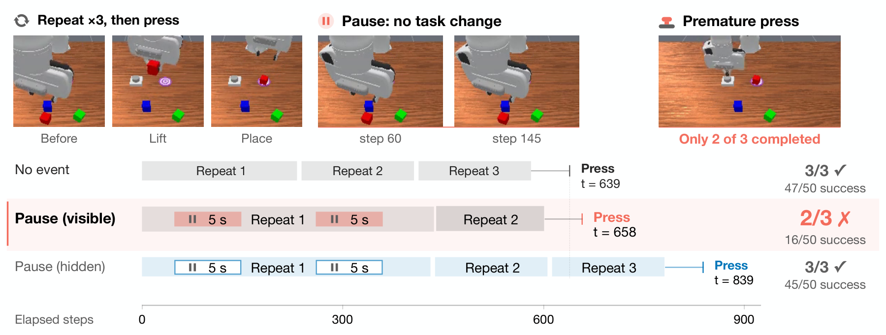
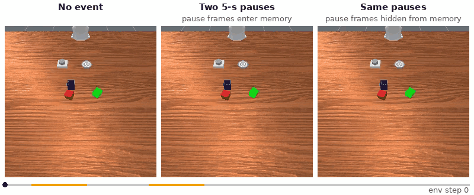
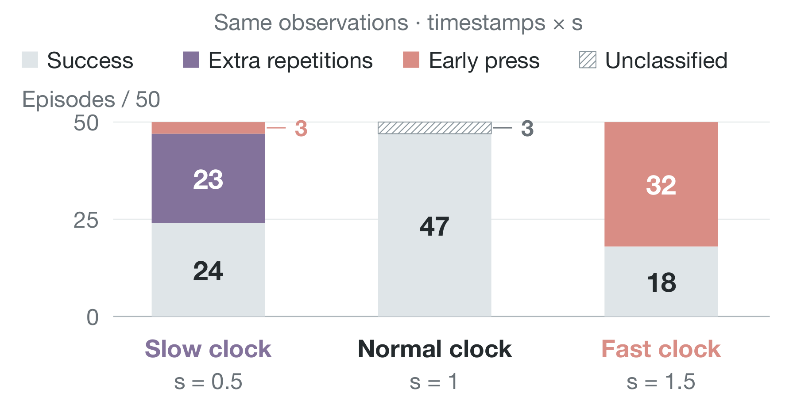
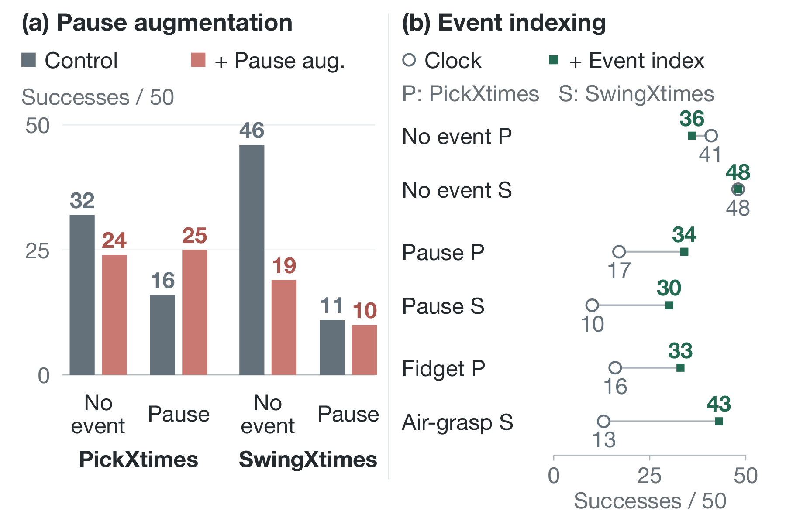
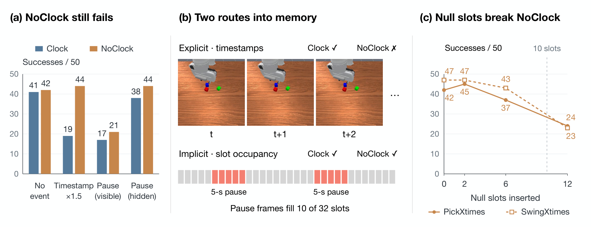

<h1 align="center">Is Your Robot's Memory Just a Clock?</h1>
<p align="center"><strong>Temporal Shortcuts in Memory-Augmented VLA Policies</strong></p>

<!-- TODO after arXiv: replace the arXiv badge link and the Citation block -->
<p align="center">
  <a href="#citation"></a>
  <a href="https://github.com/RoboMME/robomme_policy_learning"></a>
  <a href="https://huggingface.co/benni23/memory-clock"></a>
  
  
  <a href="LICENSE"></a>
</p>

<p align="center">
  <a href="#-installation">Installation</a> &nbsp;/&nbsp;
  <a href="#-quick-start">Quick Start</a> &nbsp;/&nbsp;
  <a href="#-reproduce-the-paper">Reproduce</a> &nbsp;/&nbsp;
  <a href="#-training">Training</a> &nbsp;/&nbsp;
  <a href="#citation">Citation</a>
</p>

## 📢 News

- **[2026.11]** Code released: null-event evaluation, memory controls, the test-time event index, and training with pause augmentation.

---

<p align="center"></p>
<p align="center"><em>Two 5-second pauses make a released memory VLA press the button after only 2 of 3 repetitions (47 &rarr; 16 of 50).
When the same pauses are hidden from memory, success returns (45 of 50).</em></p>

### 🎬 Demo

<p align="center"></p>
<p align="center"><em>One PickXtimes episode (K&nbsp;=&nbsp;3, released FrameSamp-Modul, front camera), cut from our evaluation videos
and played at 3.75&times; speed on a shared environment-step clock; orange marks the two 5-second pauses. Left: no event. Middle: the robot pauses and the pause frames
enter memory, so the policy presses after 2 repetitions. Right: the same pauses, hidden from memory.</em></p>

Many memory-augmented VLA policies **fill memory by time**: they sample frames uniformly over the episode and stamp
each with its time step. But time passes even when nothing happens. We show that such a memory **cannot tell waiting
from working**: a brief *null event* (a pause, a wrist fidget, a grasp at air) makes the policy count the interval as
work done and stop early. We call this failure **phantom progress**.

## 💡 Key Findings

| | Finding | Test in this repo |
|:-:|---|---|
| ⏸️ | **Phantom progress.** Pauses and fidgets cut success from 47 to 16 (PickXtimes) and 44 to 10 (SwingXtimes); almost every failure is an early stop. | `--event pause --memory visible` |
| 🙈 | **The damage passes through memory.** The same events with their frames hidden from memory cost at most 3 episodes. | `--memory hidden` |
| ⏱️ | **A temporal shortcut.** With no event at all, a faster clock makes the policy stop early and a slower one makes it repeat. | `--clock-scale 1.5` |
| 🧩 | **It lives in the index, not only the time stamps.** A policy trained without time encoding still fails, because null frames occupy slots of the time-sampled memory. | `--model noclock --control nullblock` |
| 🛠️ | **Index by events, not time.** Pause augmentation does not fix the failure; an event index at test time recovers half or more of the loss without retraining. | `--index event` |

<table>
  <tr>
    <th width="50%">Rescaling the time stamps alone shifts the failure</th>
    <th width="50%">Fixes suggested by the diagnosis</th>
  </tr>
  <tr>
    <td align="center"></td>
    <td align="center"></td>
  </tr>
</table>

<p align="center"></p>
<p align="center"><em>Removing the time encoding (NoClock) does not cure the failure: pause frames still fill slots of the time-sampled memory.</em></p>

## 🔧 Installation

Requirements: Linux, an NVIDIA GPU with CUDA 12 (80 GB+ for training), `git`, [`uv`](https://docs.astral.sh/uv/), and
Vulkan (or Mesa's lavapipe, see `--render lavapipe`).

```bash
git clone https://github.com/bennidict23/memory-clock.git && cd memory-clock
bash install.sh      # RoboMME at the pinned commits + its two environments, into third_party/
bash download.sh     # released FrameSamp-Modul policy, tokenizer, our trained policies
```

`install.sh` clones [RoboMME](https://github.com/RoboMME/robomme_policy_learning) at commit `ecf086c`
(benchmark `856bc3a`) and leaves it unmodified; it only adds our NoClock config. Set `ROBOMME_DIR` to use an existing checkout.

<details>
<summary><b>More downloads</b></summary>

```bash
bash download.sh designs   # the other released RoboMME designs of Table 2 and the VLM sub-goal predictors
bash download.sh train     # pi0.5 base weights and the preprocessed RoboMME training data (~1 TB unpacked)
```
</details>

## 📦 Checkpoints

| Model | Description | Source |
|---|---|---|
| `perceptual-framesamp-modul` | released RoboMME memory VLA (time-sampled, time-stamped memory) | [🤗 Yinpei/perceptual-framesamp-modul](https://huggingface.co/Yinpei/perceptual-framesamp-modul) |
| `clock` | the same design trained from pi0.5 base (30k steps) | [🤗 benni23/memory-clock](https://huggingface.co/benni23/memory-clock) |
| `noclock` | the same without time encoding (`use_pos_emb: false`) | [🤗 benni23/memory-clock](https://huggingface.co/benni23/memory-clock) |
| `clock-retrain` | a second training run of `clock` (control for pause augmentation) | [🤗 benni23/memory-clock](https://huggingface.co/benni23/memory-clock) |
| `pauseaug` / `pauseaug-weak` | Clock trained with pauses injected into the memory timeline | [🤗 benni23/memory-clock](https://huggingface.co/benni23/memory-clock) |

`bash download.sh` fetches all hosted checkpoints; any model can also be trained with a single command (see [Training](#-training)).

## 🚀 Quick Start

**Test run (1 episode, ~2 min on one GPU).** Checks the installation end to end: policy server, simulator, two
5-second pauses, result line.

```bash
bash run_eval.sh --episodes 1 --event pause --tag quicktest    # add --render lavapipe if GPU rendering hangs
# [run_eval] quicktest: 0/1 successes (results/quicktest/ckpt79999/seed7)
```

In our run, the first test episode ends with an early press (`results/quicktest/client.log`:
`result fail ... button pressed`). A single episode is a smoke test, not a result.

One condition = one command. It starts the policy server, runs 50 paired test episodes and prints the success count:

```bash
# released policy, PickXtimes, two 5-s pauses visible to memory
bash run_eval.sh --task PickXtimes --event pause --len 100 --memory visible
# [run_eval] perceptual-framesamp-modul__PickXtimes__pause100-visible: 16/50 successes

bash run_eval.sh --task PickXtimes --event pause --len 100 --memory hidden    # same pauses, hidden from memory
bash run_eval.sh --task PickXtimes --clock-scale 1.5                          # no event, fast clock
bash run_eval.sh --model clock --task SwingXtimes --event airgrasp-return --index event   # event index
```

<details>
<summary><b>All options</b> (<code>bash run_eval.sh --help</code>)</summary>

| Option | Values |
|---|---|
| `--model` | `perceptual-framesamp-modul` (default), other released designs, `clock`, `noclock`, `clock-retrain`, `pauseaug`, `pauseaug-weak`, `memer`, `text-subgoal`; or `--ckpt DIR` |
| `--task` | any RoboMME task (paper: `PickXtimes`, `SwingXtimes`) |
| `--event` | `none`, `pause`, `fidget`, `airgrasp`, `airgrasp-return`; `--len N` (default 100 env steps = 5 s), `--at 48,160` |
| `--memory` | `visible` (event frames enter memory) or `hidden` (they happen physically but never reach memory) |
| `--index` | `time` (stock) or `event` (test-time event index) |
| `--clock-scale S` | multiply the time stamps of all memory frames by S |
| `--control` | `nullswap`, `dupfill` (`--sim-pause`), `nullblock` (`--nb-m`): the NoClock controls |
| `--split` | `test` (default) or `val` (held-out episodes) |
| `--episodes`, `--seed` | default 50 and 7 (the paper's protocol) |
| `--render` | `default` or `lavapipe` (CPU rendering, used for the paper) |

Results go to `results/<tag>/`: `server.log`, `client.log` (one `[episode]` line per episode), and RoboMME's
`progress.json`, `log.json` and videos. Interrupted runs resume from `progress.json`.
</details>

## 🔬 Reproduce the Paper

Every main-paper number is one line of `reproduce.sh`, with the paper's count next to it
(`bash reproduce.sh list` prints all commands):

| Paper | Command | Paper result (successes / 50) |
|---|---|---|
| Fig. 2, Tab. 1 &nbsp;null events, visible vs hidden | `bash reproduce.sh fig2` | Pick 47 &rarr; 16 (pause), 45 (hidden) |
| Fig. 4 &nbsp;rescaled time stamps | `bash reproduce.sh fig4` | Pick &times;0.5: 24, &times;1.5: 18 |
| Fig. 6 &nbsp;Clock vs NoClock, controls | `bash reproduce.sh fig6` | Pick pause: Clock 17, NoClock 21 |
| Tab. 2 &nbsp;released memory designs | `bash reproduce.sh tab2` | sub-goal memories 38 &rarr; 39, 46 &rarr; 48 |
| Fig. 8a &nbsp;pause augmentation | `bash reproduce.sh fig8a` | Pick 32 / 16 &rarr; 24 / 25 (none / pause) |
| Fig. 8b &nbsp;event index | `bash reproduce.sh fig8b` | Swing air-grasp 13 &rarr; 43 |
| Held-out replication | `bash reproduce.sh heldout` | Pick pause 10 &rarr; 36 |

Each run needs one GPU for the policy server and a few CPU cores for the simulator (50 episodes take 2&ndash;4 h).
Pass extra `run_eval.sh` options through `RUN_EVAL_ARGS`, e.g. `RUN_EVAL_ARGS="--render lavapipe"`.

<details>
<summary><b>Notes on determinism</b></summary>

With default settings, GPU evaluation is not bit-exact: XLA picks GPU kernels by timing them when the server starts,
so whole episodes can change between runs (by up to 8 of 50 in the paper). For bit-identical reruns on the same GPU
type, set

```bash
export XLA_FLAGS="--xla_gpu_deterministic_ops=true --xla_gpu_autotune_level=0"
```

The paper's numbers were produced without this flag, with CPU rendering (`--render lavapipe`) on H200 GPUs.
GPU rendering produces slightly different images and may change a few episodes.
</details>

## 📈 Training

```bash
bash download.sh train
bash train.sh clock          # or: noclock, clock-retrain, pauseaug, pauseaug-weak
bash run_eval.sh --ckpt checkpoints/trained/mme_vla_scratch/clock/29999 --model clock-mine --task PickXtimes --event pause
```

`train.sh` fine-tunes pi0.5 base with the released MME-VLA recipe unchanged (30k steps, global batch 64, FSDP over
all visible GPUs; the paper used 2&ndash;4 H200s, one 80 GB GPU also fits). **Pause augmentation** inserts, with
probability 0.8, one to three pauses of 20&ndash;600 copied frames into the memory timeline of each training sample,
so that time stamps advance over them as at test time; the current observation and the actions are unchanged.

## 📁 Repository Structure

```
memory_clock/
├── eval_client.py      # null-event injection, visible / hidden memory, test-time event index
├── policy_server.py    # memory manipulations: clock scale, null swap, dup fill, null block, event index
├── train.py            # training entry point (released recipe)
├── pause_aug.py        # pause augmentation of the memory timeline
└── render_lavapipe.py  # optional CPU Vulkan rendering
configs/                # NoClock memory config
run_eval.sh             # evaluate one condition
reproduce.sh            # every main-paper run, grouped by figure
train.sh                # train one of the paper's policies
```

## 🙏 Acknowledgements

This code builds on [RoboMME](https://github.com/RoboMME/robomme_policy_learning), [openpi](https://github.com/Physical-Intelligence/openpi)
and [ManiSkill](https://github.com/haosulab/ManiSkill). We thank their authors for releasing code, data and checkpoints.
None of their code is copied here; `install.sh` fetches it.

## 📄 License

Our code is released under the [MIT License](LICENSE). Upstream code (Apache-2.0), pi0.5 / PaliGemma weights,
the released RoboMME checkpoints and Qwen3-VL keep their own licenses.

## Citation

If you find this work useful, please consider citing our paper (BibTeX coming with the arXiv version).
